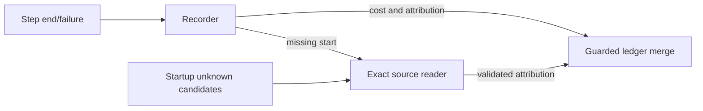

## Context

The V2 recorder keeps starts in memory; missing starts currently borrow `lastStep`. Startup fills do not repair attribution. User-approved scope is exact-message live recovery and startup repair of missing step agent/provider/model only, within existing modules and retained history. Verified source: `session_message(id, session_id, type, data)`; attribution paths are `$.agent`, `$.model.providerID`, `$.model.id`.

## Goals / Non-Goals

Recover evidence-backed attribution without compromising accounting or availability. Preserve IDs, timestamps, known fields and every non-attribution value on existing steps. No new module, dependency, schema, RPC/TUI surface, compaction change or reload change. The separately authorized local repair is outside implementation scope.

## Decisions

1. **Exact evidence, not inference.** Keep matching observed starts authoritative. Without one, remove `lastStep` fallback for **all three step fields** and use an injected exact-message reader implemented in `backfill.ts`. Require matching message ID, session ID and `type=assistant`. Validate each extracted field independently as a nonempty, non-whitespace string; reject `unknown` as recovery evidence. Partial recovery is valid; unavailable fields remain `unknown`. Keep existing timestamp selection; source timestamps never replace it. Applies to ended and eligible failed steps. Compaction retains its existing fallback.

2. **Immediate accounting, best-effort recovery.** Choose one indexed, read-only lookup over deferred cost recording: deferral risks losing accounting. Open a short-lived source connection, explicitly set SQLite busy timeout to **50 ms**, and close in `finally`. This bounds lock waiting, not total filesystem latency. Missing source, read failure, malformed data or commit races must not prevent recording. Retry unresolved rows on later startups, not with live polling/timers.

3. **Field-wise atomic repair.** Add store candidate selection for retained `kind=step` rows with any attribution field equal to `unknown`. Read source outside ledger transactions, in chunks of **500**, reusing one read-only connection for the startup pass. Match ID/session/type; update only unknown fields with validated evidence. Recheck session, kind and individual unknown guards atomically under the existing short write-transaction pattern. Stop the pass on database failure; commit prior successful chunks. No checked marker.

4. **Safe redelivery.** For existing steps, replace whole-row fallback/backfill replacement with the same guarded attribution merge, including provider-only/model-only unknowns. Preserve all non-attribution columns and known attribution regardless of redelivery or concurrent repair. Leave compaction upsert semantics unchanged.

5. **Existing lifecycle.** Run attribution repair after existing startup fills and before prune/RPC registration. Increment the instance revision only for actual repair changes. Initial RPC reads already see repaired data; no startup notification is needed. Live writes retain existing debounced notification.

6. **Minimal diagnostics.** Reuse stderr; new entries contain only fixed categories, counts and a setup-local random correlation token. Allow categories `source-unavailable`, `source-read`, `source-invalid`, `message-missing`, `message-mismatch`, `field-invalid`, `ledger-write`. Emit at most one live entry per category per setup, plus one aggregate startup summary. Never include raw IDs, paths, source content or errors; diagnostics cannot throw. Leave unrelated logs untouched.

## Risks / Trade-offs

Unknowns can persist indefinitely when evidence is absent. Work scales with retained unknown candidates; chunks bound query/write batches. Source failures degrade attribution only; accounting survives. Concurrent writers cannot overwrite known fields. Reject persisted starts/schema expansion and retry infrastructure as unnecessary scope. No schema migration is required.
